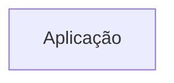
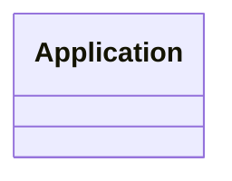

# Arquitetura

<!-- specsfy:documentator:start -->
Os diagramas são exemplos de formato. Eles não representam relações confirmadas da aplicação.

## Componentes

| Tipo | Quantidade |
| --- | --- |
| Código | 91 |
| Testes | 17 |

## Diagramas

<!-- specsfy:documentator:end -->
