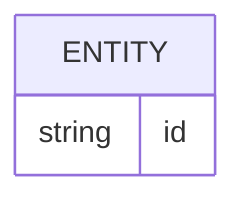

# Banco de dados

<!-- specsfy:documentator:start -->
Os diagramas são exemplos de formato. Eles não representam relações confirmadas da aplicação.

## Fontes de persistência

| Arquivo |
| --- |
| snitch/database/migrations/0001_01_01_000000_create_users_table.php |
| snitch/database/migrations/0001_01_01_000001_create_cache_table.php |
| snitch/database/migrations/0001_01_01_000002_create_jobs_table.php |
| Nenhuma estrutura confirmada além das fontes listadas. |

<!-- specsfy:documentator:end -->
